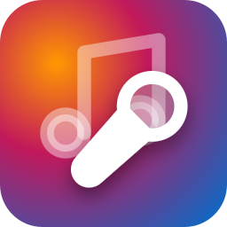
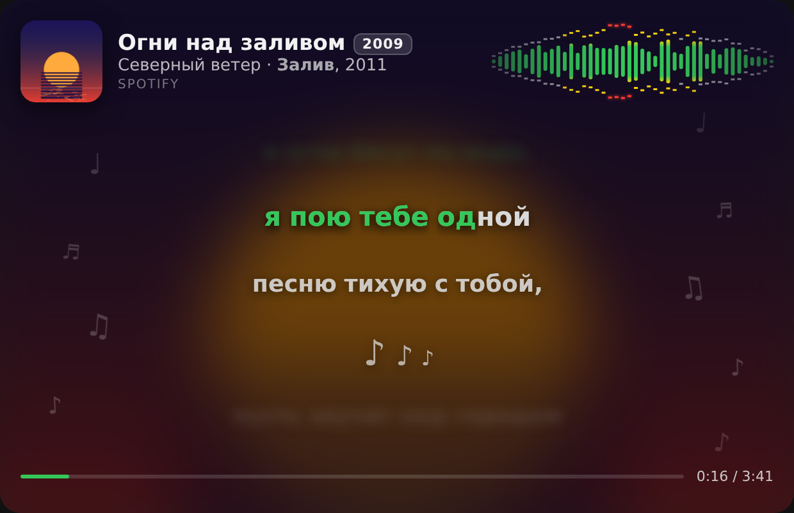
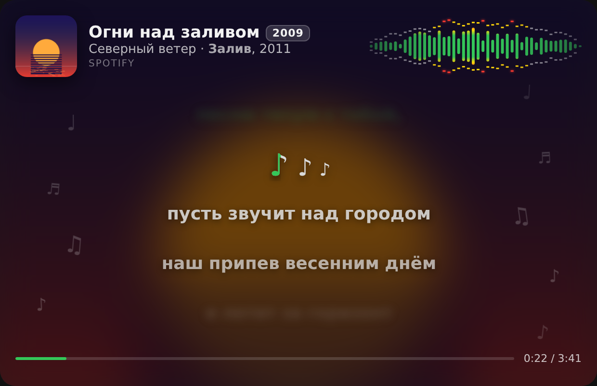
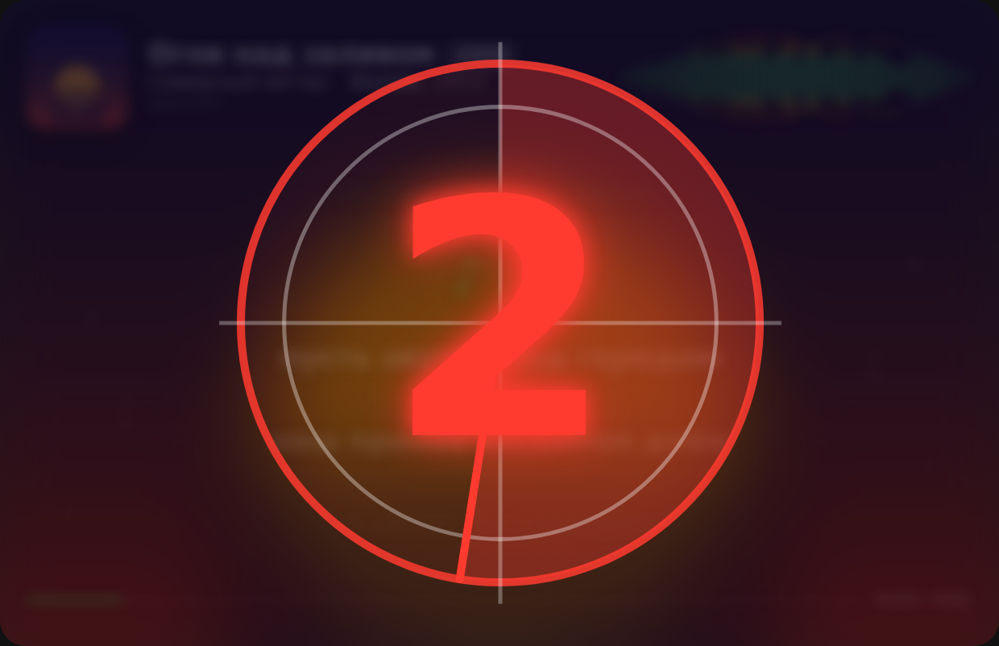

<p align="center">
  
</p>

<h1 align="center">Karaoke Lyrics Card</h1>

<p align="center">
  <b>Караоке для Home Assistant</b> · <b>Karaoke for Home Assistant</b>
</p>

<p align="center">
  <a href="https://hacs.xyz/"></a>
  <a href="https://github.com/MDV85/ha-karaoke-lyrics-card/releases"></a>
  
</p>

<p align="center">
  Синхронний текст пісні з політерним зафарбовуванням для будь-якого <code>media_player</code>.<br>
  Синхронный текст песни с побуквенной закраской для любого <code>media_player</code>.<br>
  Synced song lyrics with letter-by-letter fill for any <code>media_player</code>.
</p>

<p align="center">
  
</p>

<p align="center">
  <a href="#ua"></a>
  &nbsp;
  <a href="#ru"></a>
  &nbsp;
  <a href="#en"></a>
</p>

<div align="center">
<details>
<summary><a name="screenshots"></a></summary>
<br>

<br><br>

<br><br>

</details>
</div>

---

<a id="ua"></a>
<h2 align="center"></h2>

<h3 align="center"></h3>

- **Політерне зафарбовування** поточного рядка в такт пісні: по словах, якщо в базі є розширений LRC, інакше плавно по рядку.
- **Будь-який плеєр:** Spotify, Яндекс Станція, Apple TV, Music Assistant та інші. Режим «усі автоматично» сам знаходить плеєр, що грає.
- **Текст** з відкритої бази [LRCLib](https://lrclib.net): без ключів і реєстрації, з кешем на 30 днів.
- **Рік пісні та альбому** з [MusicBrainz](https://musicbrainz.org).
- **Програші:** три ноти зафарбовуються під час музики.
- **Відлік 3-2-1-0** у стилі кіноплівки на всю картку, після «0» є час підготуватися.
- **Оформлення:** розмита обкладинка фоном, плаваючі ноти з боків, дзеркальна хвиля в шапці (без звуку зникає).
- **Назва і виконавець:** довга назва пісні плавно прокручується, а виконавець і альбом з роком по черзі змінюють одне одного.
- **Іврит і арабська** зафарбовуються справа наліво (автовизначення).
- **Смуга прогресу**, зсув синхронізації з кроком 0,01 секунди.
- **Візуальний редактор:** усі налаштування змінюються мишкою, YAML не потрібен.
- **Три мови:** картка і редактор українською, російською та англійською. Мова вибирається сама за профілем Home Assistant (інші мови - англійська).

<h3 align="center"></h3>

1. HACS → ⋮ → **Користувацькі репозиторії**.
2. URL `https://github.com/MDV85/ha-karaoke-lyrics-card`, категорія **Dashboard** → **Додати**.
3. Знайдіть **Karaoke Lyrics Card** → **Завантажити**.
4. Оновіть сторінку браузера (Ctrl+F5).

<h3 align="center"></h3>

1. Завантажте `ha-karaoke-lyrics-card.js` з останнього [релізу](https://github.com/MDV85/ha-karaoke-lyrics-card/releases).
2. Покладіть файл у `/config/www/`.
3. Налаштування → Панелі → ⋮ → Ресурси → Додати: `/local/ha-karaoke-lyrics-card.js`, тип «JavaScript-модуль».
4. Оновіть сторінку (Ctrl+F5).

<h3 align="center"></h3>

Найпростіше через візуальний редактор: «Додати картку» → **Karaoke Lyrics Card**.

```yaml
type: custom:karaoke-lyrics-card
players_mode: auto
players:
  - media_player.spotify_xxx
  - media_player.yandex_station_xxx
exclude_players:
  - media_player.tv_xxx
```

<h3 align="center"></h3>

| Параметр | За замовчуванням | Опис |
|---|---|---|
| `players_mode` | `list` | `list` - лише зі списку; `auto` - будь-який плеєр, що грає, список задає пріоритет |
| `players` | - | Плеєри за пріоритетом (обов'язковий у режимі `list`) |
| `exclude_players` | - | Ніколи не брати ці плеєри |
| `lyrics_provider` | `lrclib` | Джерело тексту |
| `show_year` | `true` | Рік пісні та альбому |
| `layout` | `fog` | `fog` - туман, 5 рядків; `two_line`; `compact` |
| `font_size` | `19` | Розмір шрифту, px |
| `font_weight` | `700` | 400 / 500 / 700 / 800 |
| `font_family` | тема HA | Будь-який CSS-шрифт |
| `line_spacing` | `2.75` | Міжрядковий інтервал |
| `alignment` | `center` | `left` / `center` / `right` |
| `direction` | `auto` | `auto` / `ltr` / `rtl` |
| `height` | авто | Висота області тексту, px |
| `fill_color` | `#34c759` | Колір зафарбовування |
| `text_color` | `#d9d9d9` | Колір тексту |
| `countdown_color` | `#ff3b30` | Колір відліку |
| `fog_strength` | `24` | Щільність туману, % |
| `show_background` | `true` | Обкладинка фоном |
| `background_blur` | `28` | Розмиття фону, px |
| `background_brightness` | `38` | Яскравість фону, % |
| `gap_threshold` | `4` | Пауза довша - програш, с |
| `show_countdown` | `true` | Відлік 3-2-1-0 |
| `countdown_lead` | `2` | Секунд після «0» до рядка |
| `show_decor` | `true` | Плаваючі ноти |
| `decor_count` | `5` | Нот з кожного боку (1–8) |
| `decor_opacity` | `22` | Прозорість нот, % |
| `show_visualizer` | `true` | Дзеркальна хвиля |
| `visualizer_source` | `animation` | `animation` - анімація; `mic` - справжня хвиля з мікрофона пристрою (потрібен https) |
| `visualizer_width` | `220` | Ширина хвилі, px |
| `show_header` | `true` | Обкладинка і назва |
| `show_progress` | `true` | Смуга прогресу |
| `show_mode` | `true` | Підпис режиму синхронізації |
| `show_offset` | `true` | Кнопки зсуву |
| `offset_mode` | `song` | `song` - кнопки зсуву запам'ятовують зсув для кожної пісні окремо; `global` - один на всі пісні |
| `offset` | `0` | Зсув синхронізації, с |
| `title` | за мовою | Заголовок, коли нічого не грає (порожньо - «Караоке» / «Karaoke») |

Кольори можна задати рядком `#rrggbb` або списком `[r, g, b]`.

<h3 align="center"></h3>

- Плеєр має передавати `media_position` (більшість передають).
- Без синхронного тексту в базі показується звичайний текст без підсвічування.
- Рік береться з MusicBrainz, для рідкісних треків його може не бути.
- Хвиля за замовчуванням - це анімація: браузер не чує, що грає колонка чи телевізор.
- Щоб хвиля рухалася під справжній звук, виберіть у налаштуваннях «Джерело хвилі» → «Мікрофон» (`visualizer_source: mic`). Потрібен вхід у Home Assistant через https і дозвіл на мікрофон. Звук нікуди не надсилається.
- Картка не записує і не підсилює голос: мікрофон використовується лише для хвилі.

---

<a id="ru"></a>
<h2 align="center"></h2>

<h3 align="center"></h3>

- **Побуквенная закраска** текущей строки в такт песне: по словам, если в базе есть расширенный LRC, иначе плавно по строке.
- **Любой плеер:** Spotify, Яндекс Станция, Apple TV, Music Assistant и другие. Режим «все автоматически» сам находит играющий плеер.
- **Текст** из открытой базы [LRCLib](https://lrclib.net): без ключей и регистрации, с кэшем на 30 дней.
- **Год песни и альбома** из [MusicBrainz](https://musicbrainz.org).
- **Проигрыши:** три ноты закрашиваются по ходу музыки.
- **Отсчёт 3-2-1-0** в стиле киноплёнки на всю карточку, после «0» есть время подготовиться.
- **Оформление:** размытая обложка фоном, плавающие ноты по бокам, зеркальная волна в шапке (без звука исчезает).
- **Название и исполнитель:** длинное название песни плавно прокручивается, а исполнитель и альбом с годом по очереди сменяют друг друга.
- **Иврит и арабский** закрашиваются справа налево (автоопределение).
- **Полоса прогресса**, сдвиг синхронизации с шагом 0,01 секунды.
- **Визуальный редактор:** все настройки меняются мышкой, YAML не нужен.
- **Три языка:** карточка и редактор на украинском, русском и английском. Язык выбирается сам по профилю Home Assistant (другие языки - английский).

<h3 align="center"></h3>

1. HACS → ⋮ → **Пользовательские репозитории**.
2. URL `https://github.com/MDV85/ha-karaoke-lyrics-card`, категория **Dashboard** → **Добавить**.
3. Найдите **Karaoke Lyrics Card** → **Скачать**.
4. Обновите страницу браузера (Ctrl+F5).

<h3 align="center"></h3>

1. Скачайте `ha-karaoke-lyrics-card.js` из последнего [релиза](https://github.com/MDV85/ha-karaoke-lyrics-card/releases).
2. Положите файл в `/config/www/`.
3. Настройки → Панели → ⋮ → Ресурсы → Добавить: `/local/ha-karaoke-lyrics-card.js`, тип «JavaScript-модуль».
4. Обновите страницу (Ctrl+F5).

<h3 align="center"></h3>

Проще всего через визуальный редактор: «Добавить карточку» → **Karaoke Lyrics Card**.

```yaml
type: custom:karaoke-lyrics-card
players_mode: auto
players:
  - media_player.spotify_xxx
  - media_player.yandex_station_xxx
exclude_players:
  - media_player.tv_xxx
```

<h3 align="center"></h3>

| Параметр | По умолчанию | Описание |
|---|---|---|
| `players_mode` | `list` | `list` - только из списка; `auto` - любой играющий плеер, список задаёт приоритет |
| `players` | - | Плееры по приоритету (обязателен в режиме `list`) |
| `exclude_players` | - | Никогда не брать эти плееры |
| `lyrics_provider` | `lrclib` | Источник текста |
| `show_year` | `true` | Год песни и альбома |
| `layout` | `fog` | `fog` - туман, 5 строк; `two_line`; `compact` |
| `font_size` | `19` | Размер шрифта, px |
| `font_weight` | `700` | 400 / 500 / 700 / 800 |
| `font_family` | тема HA | Любой CSS-шрифт |
| `line_spacing` | `2.75` | Межстрочный интервал |
| `alignment` | `center` | `left` / `center` / `right` |
| `direction` | `auto` | `auto` / `ltr` / `rtl` |
| `height` | авто | Высота области текста, px |
| `fill_color` | `#34c759` | Цвет закраски |
| `text_color` | `#d9d9d9` | Цвет текста |
| `countdown_color` | `#ff3b30` | Цвет отсчёта |
| `fog_strength` | `24` | Плотность тумана, % |
| `show_background` | `true` | Обложка фоном |
| `background_blur` | `28` | Размытие фона, px |
| `background_brightness` | `38` | Яркость фона, % |
| `gap_threshold` | `4` | Пауза дольше - проигрыш, с |
| `show_countdown` | `true` | Отсчёт 3-2-1-0 |
| `countdown_lead` | `2` | Секунд после «0» до строки |
| `show_decor` | `true` | Плавающие ноты |
| `decor_count` | `5` | Нот с каждой стороны (1–8) |
| `decor_opacity` | `22` | Прозрачность нот, % |
| `show_visualizer` | `true` | Зеркальная волна |
| `visualizer_source` | `animation` | `animation` - анимация; `mic` - настоящая волна с микрофона устройства (нужен https) |
| `visualizer_width` | `220` | Ширина волны, px |
| `show_header` | `true` | Обложка и название |
| `show_progress` | `true` | Полоса прогресса |
| `show_mode` | `true` | Подпись режима синхронизации |
| `show_offset` | `true` | Кнопки сдвига |
| `offset_mode` | `song` | `song` - кнопки сдвига запоминают сдвиг для каждой песни отдельно; `global` - один на все песни |
| `offset` | `0` | Сдвиг синхронизации, с |
| `title` | по языку | Заголовок, когда ничего не играет (пусто - «Караоке» / «Karaoke») |

Цвета можно задать строкой `#rrggbb` или списком `[r, g, b]`.

<h3 align="center"></h3>

- Плеер должен передавать `media_position` (большинство передают).
- Без синхронного текста в базе показывается обычный текст без подсветки.
- Год берётся из MusicBrainz, для редких треков его может не быть.
- Волна по умолчанию - это анимация: браузер не слышит, что играет колонка или телевизор.
- Чтобы волна двигалась под настоящий звук, выберите в настройках «Источник волны» → «Микрофон» (`visualizer_source: mic`). Нужен вход в Home Assistant по https и разрешение на микрофон. Звук никуда не отправляется.
- Карточка не записывает и не усиливает голос: микрофон используется только для волны.

---

<a id="en"></a>
<h2 align="center"></h2>

<h3 align="center"></h3>

- **Letter-by-letter fill** of the current line in time with the song: word-level when the database has enhanced LRC, otherwise a smooth fill across the line.
- **Any player:** Spotify, Yandex Station, Apple TV, Music Assistant and more. "Auto" mode finds whichever player is playing.
- **Lyrics** from the open [LRCLib](https://lrclib.net) database: no keys or sign-up, cached for 30 days.
- **Song and album year** from [MusicBrainz](https://musicbrainz.org).
- **Instrumental breaks:** three notes fill as the music plays.
- **3-2-1-0 countdown** in film-leader style across the whole card, with time to get ready after "0".
- **Styling:** blurred album art background, floating notes on both sides, a mirrored wave in the header (it fades out when nothing is playing).
- **Title and artist:** a long song title scrolls smoothly, and the artist and the album with its year take turns.
- **Hebrew and Arabic** fill right-to-left (auto-detected).
- **Progress bar**, sync offset in steps of 0.01 seconds.
- **Visual editor:** every option is set with the mouse, no YAML needed.
- **Three languages:** the card and editor in Ukrainian, Russian and English. The language follows your Home Assistant profile (other languages - English).

<h3 align="center"></h3>

1. HACS → ⋮ → **Custom repositories**.
2. URL `https://github.com/MDV85/ha-karaoke-lyrics-card`, category **Dashboard** → **Add**.
3. Find **Karaoke Lyrics Card** → **Download**.
4. Reload the browser page (Ctrl+F5).

<h3 align="center"></h3>

1. Download `ha-karaoke-lyrics-card.js` from the latest [release](https://github.com/MDV85/ha-karaoke-lyrics-card/releases).
2. Put the file in `/config/www/`.
3. Settings → Dashboards → ⋮ → Resources → Add: `/local/ha-karaoke-lyrics-card.js`, type "JavaScript module".
4. Reload the page (Ctrl+F5).

<h3 align="center"></h3>

The easiest way is the visual editor: "Add card" → **Karaoke Lyrics Card**.

```yaml
type: custom:karaoke-lyrics-card
players_mode: auto
players:
  - media_player.spotify_xxx
  - media_player.yandex_station_xxx
exclude_players:
  - media_player.tv_xxx
```

<h3 align="center"></h3>

| Option | Default | Description |
|---|---|---|
| `players_mode` | `list` | `list` - only listed players; `auto` - any playing player, the list sets priority |
| `players` | - | Players by priority (required in `list` mode) |
| `exclude_players` | - | Never use these players |
| `lyrics_provider` | `lrclib` | Lyrics source |
| `show_year` | `true` | Song and album year |
| `layout` | `fog` | `fog` - 5 lines with fog; `two_line`; `compact` |
| `font_size` | `19` | Font size, px |
| `font_weight` | `700` | 400 / 500 / 700 / 800 |
| `font_family` | HA theme | Any CSS font |
| `line_spacing` | `2.75` | Line spacing |
| `alignment` | `center` | `left` / `center` / `right` |
| `direction` | `auto` | `auto` / `ltr` / `rtl` |
| `height` | auto | Lyrics area height, px |
| `fill_color` | `#34c759` | Fill color |
| `text_color` | `#d9d9d9` | Text color |
| `countdown_color` | `#ff3b30` | Countdown color |
| `fog_strength` | `24` | Fog density, % |
| `show_background` | `true` | Album art background |
| `background_blur` | `28` | Background blur, px |
| `background_brightness` | `38` | Background brightness, % |
| `gap_threshold` | `4` | A pause longer than this is a break, s |
| `show_countdown` | `true` | 3-2-1-0 countdown |
| `countdown_lead` | `2` | Seconds after "0" before the line |
| `show_decor` | `true` | Floating notes |
| `decor_count` | `5` | Notes per side (1–8) |
| `decor_opacity` | `22` | Note opacity, % |
| `show_visualizer` | `true` | Mirrored wave |
| `visualizer_source` | `animation` | `animation` - animation; `mic` - real wave from the device microphone (https required) |
| `visualizer_width` | `220` | Wave width, px |
| `show_header` | `true` | Album art and title |
| `show_progress` | `true` | Progress bar |
| `show_mode` | `true` | Sync mode label |
| `show_offset` | `true` | Offset buttons |
| `offset_mode` | `song` | `song` - offset buttons remember the offset per song; `global` - one offset for all songs |
| `offset` | `0` | Sync offset, s |
| `title` | by language | Title when nothing is playing (empty - "Karaoke" / "Караоке") |

Colors can be a `#rrggbb` string or an `[r, g, b]` list.

<h3 align="center"></h3>

- The player must report `media_position` (most do).
- If the database has no synced lyrics, plain lyrics are shown without the fill.
- The year comes from MusicBrainz and may be missing for rare tracks.
- By default the wave is an animation: the browser can't hear what your speaker or TV is playing.
- To make the wave follow the real sound, set "Wave source" → "Microphone" in the settings (`visualizer_source: mic`). Home Assistant must be opened over https and microphone access must be allowed. Audio is never sent anywhere.
- The card does not record or amplify your voice: the microphone is used only for the wave.

---

## Ліцензія · Лицензия · License

[MIT](LICENSE) · Зроблено в Україні з любов’ю
